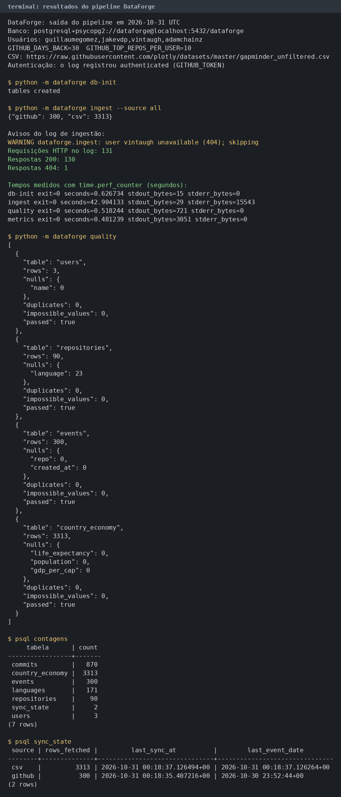

# DataForge

[](https://github.com/JVCSampaio/dataforge/actions/workflows/ci.yml) · [Portfólio](https://github.com/JVCSampaio)

**Data platform** end-to-end: ingesta dados **reais** de fontes heterogêneas (API GitHub + CSV público), aplica **controle de qualidade**, persiste em **PostgreSQL** com modelagem relacional, expõe **analytics via SQL não trivial** e serve tudo por uma **API REST (FastAPI)** — tudo dentro de **Docker** com **CI** no GitHub Actions.

O fluxo integra ingestão, qualidade, armazenamento e consumo analítico. As decisões técnicas e instruções de execução estão documentadas abaixo.

## Funcionalidades e implementação

| Capacidade | Implementação |
|---|---|
| **Ingestão incremental** | `sync_state` + `since` na API de eventos |
| **Idempotência** | upserts + chaves únicas (`full_name`, `sha`, `(country, year)`) |
| **Data quality** | `quality.py`: nulls, duplicatas, schema, valores impossíveis |
| **Modelagem relacional** | `users`, `repositories`, `languages`, `events`, `commits`, `country_economy` |
| **SQL não trivial** | CTEs, `ROW_NUMBER()`, `LAG()`, `date_trunc`, JOINs |
| **API de analytics** | FastAPI: `/metrics/*`, `/quality`, `/health` |
| **Reprodutibilidade** | Dockerfile, `docker-compose.yml`, CI |

## Arquitetura

```
        ┌─────────────┐      ┌─────────────┐
        │  GitHub API │      │  CSV público│
        └──────┬──────┘      └──────┬──────┘
               │   (incremental)    │
               ▼                    ▼
        ┌──────────────────────────────────┐
        │  Ingestion (Python)              │
        │  - events since last sync        │
        │  - upsert users/repos/languages  │
        │  - upsert country_economy        │
        └───────────────┬──────────────────┘
                        ▼
        ┌──────────────────────────────────┐
        │  Data Quality                    │
        │  nulls / dups / schema / range   │
        └───────────────┬──────────────────┘
                        ▼
        ┌──────────────────────────────────┐
        │  PostgreSQL                      │
        │  users, repositories, languages, │
        │  events, commits, country_economy│
        │  sync_state                      │
        └───────────────┬──────────────────┘
                        ▼
        ┌──────────────────────────────────┐
        │  Analytics (SQL)                 │
        │  CTE / window fn / aggregation   │
        └───────────────┬──────────────────┘
                        ▼
        ┌──────────────────────────────────┐
        │  FastAPI  →  /metrics, /quality  │
        └──────────────────────────────────┘
```

## Fontes de dados

- **GitHub REST API** (público, sem token): perfis de `guillaumegomez`, `jakevdp`, `vintaugh`, `adamchainz` (contribuidores ativos de projetos open-source); seus repositórios, linguagens, eventos recentes e commits.
- **CSV público** (Gapminder): `country`, `year`, `life_expectancy`, `population`, `gdp_per_cap` — ~3.300 linhas.

## Como rodar

### Docker (recomendado)

```bash
docker compose up --build
```

Sobe o Postgres, cria as tabelas, roda a ingestão e sobe a API em `http://localhost:8000`.

### Manual (sem Docker)

```bash
# 1. banco (docker ou local)
docker run -d -p 5432:5432 -e POSTGRES_USER=dataforge \
  -e POSTGRES_PASSWORD=dataforge -e POSTGRES_DB=dataforge postgres:16-alpine

# 2. dependências
python -m venv .venv && .venv\Scripts\activate        # Windows
pip install -r requirements.txt
set PYTHONPATH=src                                       # Windows (ou export PYTHONPATH=src)

# 3. criar tabelas
python -m dataforge db-init

# 4. ingerir (incremental — rode quantas vezes quiser)
python -m dataforge ingest --source all

# 5. qualidade e métricas
python -m dataforge quality
python -m dataforge metrics

# 6. API
python -m dataforge serve
```

## Resultados

Execução medida em 31/10/2026, com banco vazio, no PostgreSQL local `dataforge`. A configuração foi a padrão de `src/dataforge/config.py`: usuários `guillaumegomez`, `jakevdp`, `vintaugh` e `adamchainz`, `GITHUB_DAYS_BACK=30`, `GITHUB_TOP_REPOS_PER_USER=10` e o CSV público `gapminder_unfiltered.csv`. O log da ingestão registrou `authenticated (GITHUB_TOKEN)`.

Comandos, nesta ordem: `db-init`, `ingest --source all`, `quality`, `metrics`. Os tempos são a duração medida de cada comando, com `time.perf_counter`.

| Comando | Saída | Tempo (s) |
|---|---|---|
| `db-init` | exit 0, `tables created` | 0,626734 |
| `ingest --source all` | `{"github": 300, "csv": 3313}` | 42,904133 |
| `quality` | exit 0, 4 relatórios | 0,518244 |
| `metrics` | exit 0 | 0,481239 |

A soma desses quatro tempos é 44,530350 s.

O retorno do `ingest` conta linhas novas: 300 eventos de GitHub e 3313 linhas do CSV. As outras tabelas foram contadas no Postgres ao final da carga.

| Tabela | Linhas |
|---|---|
| users | 3 |
| repositories | 90 |
| languages | 171 |
| events | 300 |
| commits | 870 |
| country_economy | 3313 |
| sync_state | 2 |

`sync_state` gravou `rows_fetched` 300 para `github` (fim em 2026-10-31 00:18:35 UTC) e 3313 para `csv` (2026-10-31 00:18:37 UTC).

Qualidade (`python -m dataforge quality`): 4 relatórios, 4 com `passed` verdadeiro e 0 com `passed` falso. Duplicatas e valores impossíveis ficaram em 0 nas quatro tabelas. Nulos medidos: `users.name` 0, `repositories.language` 23, `events.repo` 0, `events.created_at` 0, `country_economy.life_expectancy` 0, `country_economy.population` 0, `country_economy.gdp_per_cap` 0. O critério `passed` do código só falha quando há valor impossível, então os 23 idiomas nulos não reprovam o relatório de `repositories`.

O log da ingestão tem 131 requisições HTTP: 130 respostas 200 e 1 resposta 404. O único aviso foi `user vintaugh unavailable (404); skipping`, e a tabela `users` ficou com 3 linhas.

A saída capturada está em [docs/resultados-pipeline.png](docs/resultados-pipeline.png).



## API (exemplos)

| Endpoint | O que retorna |
|---|---|
| `GET /health` | `{"status":"ok"}` |
| `GET /metrics/top-repos?limit=10` | Top repos por estrelas |
| `GET /metrics/language-share` | Contagem + estrelas por linguagem |
| `GET /metrics/event-activity?user=pandas-dev` | Eventos por mês |
| `GET /metrics/repo-ranking` | Ranking por owner com `ROW_NUMBER` + `LAG` |
| `GET /metrics/gdp-life?year=2007` | PIB per capita × expectativa de vida |
| `GET /metrics/life-trend?country=Brazil` | Série temporal de expectativa de vida |
| `GET /metrics/event-types` | Distribuição de tipos de evento |
| `GET /quality` | Relatório de qualidade das 4 tabelas |

Documentação interativa: `http://localhost:8000/docs`.

## Testes e CI

```bash
python -m pytest -v          # 15 testes (ingestão, qualidade, analytics, API, Airflow, n8n)
python -m ruff check src tests
```

O workflow `.github/workflows/ci.yml` sobe um Postgres efêmero, roda a ingestão, os testes e o linter em cada push.

## Orquestração

### Apache Airflow

A DAG `dataforge_etl` fica em `orchestration/airflow/dags/dataforge_etl.py`. Ela cria as tabelas, ingere GitHub e CSV em paralelo e, no fim, roda a qualidade. Se algum relatório vier com `passed` falso, a tarefa `verificar_qualidade` falha.

Agenda: `0 6 * * *` (todo dia às 06:00 UTC). `catchup` está desligado. Cada tarefa tem `retries` 2 e espera 5 minutos entre tentativas.

O Airflow 3.3 usa o mesmo Postgres do projeto, no banco `airflow`, com `LocalExecutor`. O banco de metadados é criado pelo script `orchestration/airflow/init-airflow-db.sql` quando o volume do Postgres é novo. Se o volume já existir, crie o banco uma vez:

```bash
docker compose exec db psql -U dataforge -d dataforge -c "CREATE DATABASE airflow;"
```

Suba o Postgres e o Airflow com o perfil `airflow`:

```bash
docker compose --profile airflow up --build db airflow
```

A interface fica em `http://localhost:8080`. Na primeira subida, o comando `standalone` gera a senha do usuário `admin` e imprime no log do contêiner. O código do projeto é montado em `/opt/airflow/dataforge/src` e entra no `PYTHONPATH`. A variável `DATABASE_URL` aponta para o banco `dataforge` no serviço `db`. Se quiser autenticar a API do GitHub, exporte `GITHUB_TOKEN` no host antes do `docker compose`. Não grave o token no repositório.

Para disparar uma execução manual dentro do contêiner:

```bash
docker compose --profile airflow exec airflow airflow dags test dataforge_etl 2026-10-31
```

Teste de importação, sem subir o agendador. Use um ambiente com Apache Airflow 3.3 e o arquivo de constraints da sua versão de Python (`constraints-3.11.txt` ou `constraints-3.12.txt`):

```bash
pip install "apache-airflow==3.3.2" --constraint "https://raw.githubusercontent.com/apache/airflow/constraints-3.3.2/constraints-3.12.txt"
python -m pytest tests/test_airflow_dag.py -v
```

O teste carrega a pasta da DAG com `DagBag` e falha se houver erro de importação. Sem o pacote instalado, esse caso é ignorado, para o CI principal continuar só com as dependências de `requirements.txt`.

### n8n

O arquivo `orchestration/n8n/dataforge_resumo.json` é uma exportação para importar no n8n. O fluxo tem três nós:

1. Gatilho agendado, cron `0 6 * * *`.
2. Execute Command, que roda `python -m dataforge ingest --source all` e em seguida `python -m dataforge quality`.
3. HTTP Request, que envia `stdout` e o código de saída para `https://webhook.example.com/dataforge/resumo`.

A credencial do webhook é só um placeholder (`CREDENCIAL_WEBHOOK_PLACEHOLDER`). O JSON não traz senha, token nem cabeçalho real. O workflow vem com `active` falso.

Como importar:

1. No n8n, abra Workflows e escolha Import from File.
2. Selecione `orchestration/n8n/dataforge_resumo.json`.
3. Crie uma credencial do tipo Header Auth e associe ao nó "Enviar resumo". Use o segredo só na interface do n8n.
4. No ambiente do n8n, defina `PYTHONPATH` com o diretório `src` do projeto e `DATABASE_URL` com a conexão do Postgres. O comando do nó não embute esses valores.
5. Se a instância bloquear o nó Execute Command, libere `n8n-nodes-base.executeCommand` apenas em máquina local.
6. Execute o fluxo uma vez manualmente. Ative o agendamento depois que o resumo chegar no webhook.

O teste `tests/test_n8n_workflow.py` confere se o arquivo é uma exportação bem formada: nós, conexões, gatilho, comando do pipeline, webhook e credencial placeholder.

## Decisões técnicas (o "por quê")

- **Pandas, não Spark.** O volume aqui é de milhares de linhas — pandas é a ferramenta certa. Spark seria over-engineering; um entrevistador pergunta "por que Spark?" e a resposta honesta é "não precisava".
- **`httpx` direto, não PyGithub.** Menos dependências, controle total sobre paginação e `since`.
- **Upsert em vez de `INSERT`.** Garante idempotência sem lógica de "já existe?" espalhada.
- **`sync_state` por fonte.** Cada fonte guarda onde parou; a próxima execução só busca o delta.
- **SQL no banco, não em Python.** Analytics com CTE/window function mostra que o banco é o motor de análise, não um dump.

## Estrutura

```
dataforge/
├── src/dataforge/
│   ├── config.py          # Settings (env)
│   ├── github_client.py   # cliente REST mínimo
│   ├── ingest.py          # ingestão incremental + upsert
│   ├── quality.py         # checks de qualidade
│   ├── analytics.py       # SQL não trivial
│   ├── api.py             # FastAPI
│   ├── cli.py             # db-init / ingest / quality / metrics / serve
│   └── db/
│       ├── models.py      # schema SQLAlchemy
│       ├── session.py
│       └── migrate.py
├── migrations/001_init.sql
├── tests/                 # pytest (ingest, quality, analytics, api)
├── orchestration/
│   ├── airflow/
│   │   ├── dags/dataforge_etl.py
│   │   ├── Dockerfile
│   │   ├── requirements.txt
│   │   └── init-airflow-db.sql
│   └── n8n/
│       └── dataforge_resumo.json
├── docs/resultados-pipeline.png
├── .github/workflows/ci.yml
├── Dockerfile
├── docker-compose.yml
├── requirements.txt
├── Makefile
└── README.md
```

## Limitações e roadmap

**Limitações (honestas):**
- Sem autenticação na API (read-only, uso local).
- Sem retenção/limpeza de eventos antigos (cresce com o tempo).
- A CLI de qualidade reporta e não interrompe o processo. A tarefa `verificar_qualidade` da DAG falha quando algum relatório vem com `passed` falso.

**Roadmap (próxima iteração, proposital):**
- **dbt** para modelar as camadas `staging → marts`.
- **DuckDB** para analytics ad-hoc sem subir o Postgres.
- **PySpark** — *somente* se o volume passar de ~10M de linhas; hoje não é o caso.

## Licença

MIT — veja [LICENSE](LICENSE).
